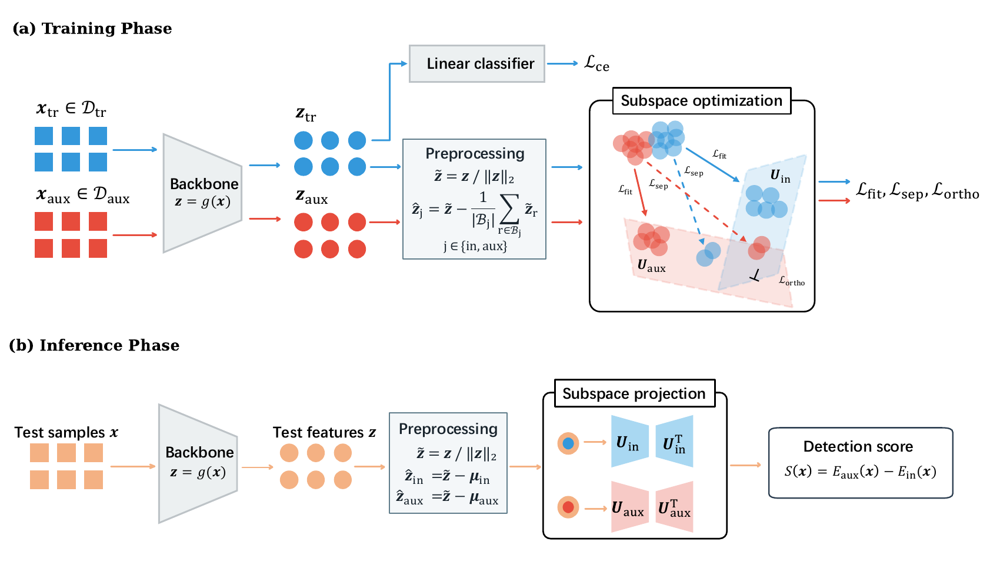

# Subspace Learning with Outlier Exposure for Out-of-Distribution Detection

We propose <strong>RecOE</strong>, an outlier exposure (OE) framework that learns feature subspaces from in-distribution data and auxiliary outliers. The subspaces capture the dominant variations of their respective distributions, and the difference between their reconstruction errors serves as the out-of-distribution detection score.

[Method](#method) · [Results](#results) · [Dataset and Environment](#dataset-and-environment)  · [Training](#training) · [Testing](#testing) · [Released checkpoints](#released-checkpoints)

## Method



RecOE jointly optimizes the classifier and two orthonormal subspace bases using

$$
\mathcal{L} =
\mathcal{L}_{\mathrm{CE}} +
\gamma\left(
\mathcal{L}_{\mathrm{fit}} +
\mathcal{L}_{\mathrm{sep}} +
\beta\mathcal{L}_{\mathrm{ortho}}
\right).
$$

Cross-entropy supervises InD classification. The subspace terms encourage reconstruction within each distribution, separation from the opposing distribution, and reduced overlap between the bases.

The OOD detection score compares the two reconstruction errors using the saved EMA feature centers.

$$
S(x) = E_{\mathrm{aux}}(x) - E_{\mathrm{in}}(x).
$$

Here, $E_j(x)$ is the squared reconstruction error in subspace $j$. 

## Results

Values are mean ± standard deviation over three trials, in percent. FPR95 and AUROC are averaged across the OOD test datasets for each benchmark.

<table>
  <thead>
    <tr>
      <th rowspan="2" align="center" valign="middle">Method</th>
      <th colspan="3" align="center"><div align="center">CIFAR-10</div></th>
      <th colspan="3" align="center"><div align="center">ImageNet-1K</div></th>
    </tr>
    <tr>
      <th align="center">FPR95 ↓</th>
      <th align="center">AUROC ↑</th>
      <th align="center">ID-ACC ↑</th>
      <th align="center">FPR95 ↓</th>
      <th align="center">AUROC ↑</th>
      <th align="center">ID-ACC ↑</th>
    </tr>
  </thead>
  <tbody>
    <tr>
      <td>OE</td>
      <td align="center">13.76 ± 0.23</td>
      <td align="center">97.53 ± 0.03</td>
      <td align="center">94.51 ± 0.06</td>
      <td align="center">61.94 ± 0.03</td>
      <td align="center">81.58 ± 0.01</td>
      <td align="center">75.90 ± 0.00</td>
    </tr>
    <tr>
      <td>DivOE</td>
      <td align="center">11.66 ± 0.04</td>
      <td align="center">97.82 ± 0.04</td>
      <td align="center"><strong>94.66 ± 0.12</strong></td>
      <td align="center">60.12 ± 0.11</td>
      <td align="center">81.96 ± 0.00</td>
      <td align="center">75.73 ± 0.02</td>
    </tr>
    <tr>
      <td>PFS</td>
      <td align="center">8.95 ± 0.40</td>
      <td align="center">95.43 ± 0.13</td>
      <td align="center">94.36 ± 0.11</td>
      <td align="center">60.19 ± 0.21</td>
      <td align="center">83.27 ± 0.10</td>
      <td align="center"><strong>76.35 ± 0.01</strong></td>
    </tr>
    <tr>
      <td><strong>RecOE</strong></td>
      <td align="center"><strong>4.36 ± 0.76</strong></td>
      <td align="center"><strong>98.68 ± 0.24</strong></td>
      <td align="center">94.65 ± 0.06</td>
      <td align="center"><strong>36.32 ± 2.04</strong></td>
      <td align="center"><strong>91.06 ± 0.20</strong></td>
      <td align="center">75.69 ± 0.07</td>
    </tr>
  </tbody>
</table>

## Dataset and Environment

| InD benchmark | Backbone | Auxiliary  data | OOD test datasets |
| --- | --- | --- | --- |
| CIFAR-10 | WideResNet-40-2 | Tiny ImageNet | Textures, Places365, iSUN, LSUN Crop, LSUN Resize |
| ImageNet-1K | ResNet-50 | ImageNet-21K-P | iNaturalist, SUN, Places, Textures |

Download the datasets by following the instructions in the [DivOE repository](https://github.com/ZFancy/DivOE#datasets).

The experiment environment uses Python 3.7, PyTorch 1.12.1, torchvision 0.13.1, CUDA 11.6, and Geoopt 0.5.0. Run the following commands from the repository root. Subsequent training and evaluation commands run from `src/`.

```bash
conda env create -f environment.yml
conda activate torch112_py37
cd src
```

## Training

**CIFAR-10.** Fine-tune WideResNet-40-2 for 10 epochs using the CIFAR-10 pretrained checkpoint available in the [DivOE repository](https://github.com/ZFancy/DivOE#pretrained-models).

```bash
python train_RecOE_CIFAR.py --dataset cifar10 --ngpu 1 \
  --cifar_root "${CIFAR_ROOT:?Set CIFAR_ROOT}" \
  --tiny_imagenet_root "${TINY_IMAGENET_ROOT:?Set TINY_IMAGENET_ROOT}" \
  --load "${CIFAR_PRETRAINED_DIR:?Set CIFAR_PRETRAINED_DIR}" \
  --save ./snapshots/RecOE/cifar10
```

**ImageNet-1K.** Fine-tune ResNet-50 for four epochs. The trainer downloads the PyTorch initialization weights on first use. 
```bash
python train_RecOE_ImageNet.py --ngpu 1 \
  --imagenet_train_root "${IMAGENET_TRAIN_ROOT:?Set IMAGENET_TRAIN_ROOT}" \
  --imagenet_val_root "${IMAGENET_VAL_ROOT:?Set IMAGENET_VAL_ROOT}" \
  --imagenet21k_root "${IMAGENET21K_ROOT:?Set IMAGENET21K_ROOT}" \
  --save ./snapshots/RecOE/imagenet
```


## Testing

Evaluate a trained RecOE model by setting `CIFAR_CHECKPOINT_DIR` or `IMAGENET_CHECKPOINT_DIR` to the directory containing its matching backbone and subspace checkpoint pair. 

**CIFAR-10.** Set `CIFAR_METHOD_NAME` to the checkpoint filename prefix before `_epoch_<N>.pt` or `_subspace_epoch_<N>.pt`. For the released CIFAR-10 checkpoints, use `cifar10_wrn_s1_recoe_tune_progressive_stiefel`.

```bash
python test_RecOE_CIFAR.py --dataset cifar10 \
  --method_name "${CIFAR_METHOD_NAME:?Set CIFAR_METHOD_NAME}" \
  --load "${CIFAR_CHECKPOINT_DIR:?Set CIFAR_CHECKPOINT_DIR}" \
  --cifar_root "${CIFAR_ROOT:?Set CIFAR_ROOT}" \
  --ood_root "${CIFAR_OOD_ROOT:?Set CIFAR_OOD_ROOT}" \
  --score_mode dual --score_sign original --strict_ood_paths
```

**ImageNet-1K.** 

```bash
python test_RecOE_ImageNet.py \
  --load "${IMAGENET_CHECKPOINT_DIR:?Set IMAGENET_CHECKPOINT_DIR}" \
  --imagenet_val_root "${IMAGENET_VAL_ROOT:?Set IMAGENET_VAL_ROOT}" \
  --ood_root "${IMAGENET_OOD_ROOT:?Set IMAGENET_OOD_ROOT}" \
  --score_mode dual --score_sign original --strict_ood_paths
```

To test the [released checkpoints](#released-checkpoints), use `./snapshots/cifar10` or `./snapshots/imagenet` as the checkpoint directory when running from `src/`.

## Released checkpoints

Each checkpoint pair contains a fine-tuned backbone and the corresponding subspace bases and EMA feature centers. Clone the repository with Git to obtain the files.

| Benchmark | Backbone | Checkpoint pair | Saved epoch | ID / auxiliary rank |
| --- | --- | --- | --- | --- |
| CIFAR-10 | WideResNet-40-2 | [`snapshots/cifar10`](src/snapshots/cifar10) | 9 (zero-based) | 64 / 64 |
| ImageNet-1K | ResNet-50 | [`snapshots/imagenet`](src/snapshots/imagenet) | 4 (one-based) | 512 / 512 |


## Acknowledgements and license

RecOE builds on DivOE and incorporates code from other upstream projects. Original RecOE contributions and the released checkpoints are licensed under the MIT License. Third-party components retain their respective licenses. [License](LICENSE) · [Third-party notices](THIRD_PARTY_NOTICES.md)
